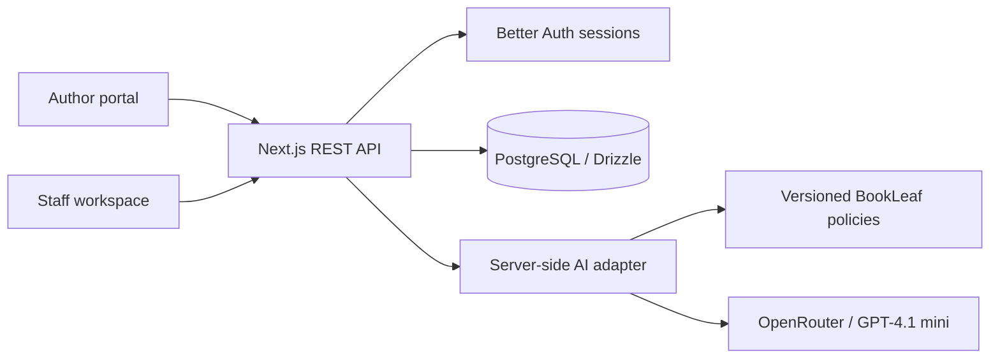

# BookLeaf Author Support Portal

A full-stack support workspace for authors and publishing operations teams. Authors can review their books and royalties, raise contextual queries, and follow responses. Staff can manage the queue with AI-assisted classification, priority suggestions, and editable replies grounded in BookLeaf's publishing policies.

**[Live demo](https://bookleaf-author-support-ayush-343s-projects.vercel.app/) · [API specification](openapi.json) · [Engineering approach](APPROACH.md) · [One-page PDF](output/pdf/bookleaf-approach.pdf)**

## Hosted assessment demo

The hosted application contains the supplied **10 authors and 18 books** in a dedicated Neon PostgreSQL database.

| Role | Email | Demo password |
|---|---|---|
| Author | `priya.sharma@email.com` | `2nzcM2bg3IPh-6iPMrH---Uu` |
| Staff | `admin1@bookleaf.example` | `2nzcM2bg3IPh-6iPMrH---Uu` |

These credentials are for the shared assessment environment. Use synthetic support queries during review. The source repository includes a synthetic seed; the supplied assessment JSON is imported separately and is not redistributed here.

### Review the complete workflow

1. Sign in as the author. Open a book and review its publication status, sales, and royalty balance.
2. Submit a ticket linked to that book. Example: "My test copy has loose pages. What evidence is needed for a reprint?"
3. Open a separate browser profile or private window and sign in as staff.
4. Open the ticket, review the AI's category and priority rationale, and inspect the draft's policy sources. Edit the suggested response before sending.
5. Leave the author's conversation open. The staff response appears through polling without a page refresh. Internal notes and activity history remain visible only to staff.

## Capabilities

| Author portal | Staff workspace |
|---|---|
| Bookshelf with publication details and production status | Searchable queue with status, category, priority, date, and assignment filters |
| Sales and royalty summaries calculated from owned records | AI classification and priority suggestions with manual overrides |
| Book-specific or account-level support tickets | Editable AI drafts with policy sources and facts to verify |
| Topic-specific guidance during ticket intake | Assignment, status changes, internal notes, and activity history |
| Public conversations with near-real-time updates | Version checks for concurrent edits and stale drafts |

The interface adapts from a desktop conversation workspace to separate queue and conversation views on mobile. Filters and selected-ticket state are reflected in the URL.

## Architecture



A single Next.js deployment serves the interface and REST API. Authorization, ticket rules, persistence, and model calls stay on the server. The browser refreshes visible ticket data every five seconds using TanStack Query.

| Technology | Responsibility and rationale |
|---|---|
| Next.js, React, TypeScript | One deployable application with typed UI and API code |
| PostgreSQL, Drizzle ORM | Relational ownership, transactional ticket updates, and versioned migrations |
| Better Auth | Email/password authentication and session management |
| TanStack Query | Server-state caching, polling, and mutation recovery |
| Zod | Request validation and structured model-output validation |
| OpenRouter | Server-side access to the configured language model |
| Vercel, Neon | Application hosting and a dedicated managed PostgreSQL database |
| Lato, Lucide, CSS tokens | Consistent typography, functional icons, and responsive interface styling |

### Data and consistency

- Server-side profiles determine whether a session belongs to an author or staff member. Author queries are scoped to ownership.
- Books retain the supplied metadata. Messages, internal notes, AI runs, and ticket events are stored separately.
- Tickets and public messages use operation IDs to handle duplicate requests. Ticket edits use version checks to detect concurrent changes.
- Status, assignment, category, and priority events are written in the same transaction as the change. Author follow-ups reopen resolved tickets; closed tickets reject public replies.
- Author responses exclude internal notes, staff activity, and private AI metadata.

### Repository layout

```text
src/app/
  components/       Author, inbox, conversation, and shared UI components
  api/auth/         Better Auth route handlers
  api/v1/           REST endpoints and ticket workflow rules
  portal.tsx        Session-aware portal orchestration
  style.css         Design tokens and responsive styles
src/server/
  ai.ts             Policies, prompt construction, redaction, and model adapter
  auth.ts           Authentication configuration
  schema.ts         Database schema
  seed.ts           Synthetic and supplied-data import
  db.ts             Database connection
scripts/            Integration, AI, and browser verification
drizzle/           SQL migrations and schema snapshots
```

## AI integration

AI assists staff with triage and drafting. Staff remain responsible for reviewing and sending every response.

### Request lifecycle

1. **Persist the ticket.** Classification runs after saving, so provider failure does not discard the author's query.
2. **Suggest triage.** Structured output selects one of the six assessment categories and four priorities, with a short rationale. Staff overrides are preserved during retries.
3. **Build bounded context.** Draft requests include the subject, description, up to three recent public replies, relevant linked-book facts, and selected policy sections.
4. **Validate the draft.** JSON Schema and Zod validate the response. The interface displays policy references and missing facts beside the composer.
5. **Review and send.** Using a draft carries its ticket version into the composer. A stale send is rejected while preserving the edited text, allowing staff to refresh or explicitly send a manual reply.

### Model choice and safeguards

The default model is `openai/gpt-4.1-mini`, accessed through OpenRouter. It was selected for structured output support and the cost of this bounded text task. `OPENROUTER_MODEL` makes the choice configurable.

| Concern | Implementation |
|---|---|
| Policy grounding | Versioned royalty, ISBN, printing, distribution, production, and general policies |
| Data minimization | Author profiles, contact fields, account IDs, and internal notes are excluded from model input |
| Free-text identifiers | Recognizable email addresses, phone numbers, and banking identifiers are redacted |
| Unsupported claims | Prompts distinguish recorded facts from author reports and prohibit invented bank status, deadlines, or completed actions |
| Cost controls | Selected context, draft caching, output caps of 180 classification tokens and 500 draft tokens |
| Usage limits | Default of 100 AI attempts per database day and 20 per actor; attempts count toward the allowance even if generation fails |
| Provider failure | Eight-second classification and fifteen-second draft deadlines; manual classification and replies remain available |
| Observability | AI-run records include state and, on success, model, usage, and latency |

Draft caching includes the ticket version, context, model, and policy version. AI use with imported assessment records requires `BOOKLEAF_ALLOW_IMPORTED_AI=1` after authorization to share the relevant fields.

## Local development

### Requirements

- Node.js 24 LTS and npm
- PostgreSQL for a persistent development database, or the embedded preview below
- An OpenRouter key to exercise live AI features; manual workflows work without one

### Quick preview

```sh
git clone https://github.com/ayush-343/BookLeaf.git
cd BookLeaf
npm ci
npm run build
npm run demo
```

Open `http://127.0.0.1:3300`. The preview starts a temporary PostgreSQL database, seeds synthetic records, and prints its login credentials. Its database is removed when the preview stops. AI is disabled by default; set `BOOKLEAF_DEMO_AI=1` with a server-side OpenRouter key to enable it.

### Persistent development database

```sh
cp .env.example .env.local
```

Configure the variables below, then run:

```sh
node --env-file=.env.local --run db:migrate
node --env-file=.env.local --run db:seed
npm run dev
```

| Variable | Purpose |
|---|---|
| `DATABASE_URL` | PostgreSQL connection string |
| `BETTER_AUTH_SECRET` | Random session secret of at least 32 characters |
| `BETTER_AUTH_URL` | Application origin; `http://localhost:3000` locally |
| `DEMO_PASSWORD` | Seeded account password of at least 12 characters |
| `OPENROUTER_API_KEY` | Optional server-side AI credential |
| `OPENROUTER_MODEL` | Model identifier; defaults to `openai/gpt-4.1-mini` |
| `AI_DAILY_LIMIT` | Shared daily allowance; defaults to `100` |
| `BOOKLEAF_SEED_FILE` | Optional path to the supplied assessment JSON |
| `BOOKLEAF_ALLOW_IMPORTED_AI` | Set to `1` only when model processing of imported records is authorized |

The default seed provides `author1@bookleaf.example` and `admin1@bookleaf.example`, using `DEMO_PASSWORD`. Seed reruns preserve existing accounts, passwords, books, and tickets.

### Import the assessment dataset

Set `BOOKLEAF_SEED_FILE` before the first seed in a **fresh database**. Synthetic and supplied records share identifiers, so seeding one over the other does not replace the existing records.

For a separate persistent assessment preview, build the application and run:

```sh
BOOKLEAF_SEED_FILE="/absolute/path/to/supplied-data.json" \
LOCAL_DEMO_PORT=3310 npm run demo:assessment
```

This serves `http://127.0.0.1:3310` and retains its database in the ignored `.local/assessment-db` directory. Sign in with an author email from the supplied file or `admin1@bookleaf.example`, using the printed preview password. Enabling imported-data AI also requires `BOOKLEAF_DEMO_AI=1` and `BOOKLEAF_ALLOW_IMPORTED_AI=1`.

## API reference

The [OpenAPI specification](openapi.json) documents the REST contract. Business endpoints use `/api/v1`; authentication uses `/api/auth`. Sessions use cookies, mutations require the application origin, and inputs are validated on the server.

| Method | Endpoint | Access / purpose |
|---|---|---|
| GET | `/me` | Signed-in identity and role |
| GET | `/books`, `/books/:id` | Owned books; staff can access all books |
| GET | `/tickets` | Owned tickets or filtered staff queue |
| POST | `/tickets` | Author ticket creation with an operation ID |
| GET | `/tickets/:id` | Role-specific conversation and context |
| PATCH | `/tickets/:id` | Staff status, assignment, category, or priority update with a version |
| POST | `/tickets/:id/messages` | Public reply with an operation ID and optional draft version |
| POST | `/tickets/:id/notes` | Staff-only internal note |
| POST | `/tickets/:id/ai-classification` | Staff classification retry |
| POST | `/tickets/:id/ai-draft` | Staff draft generation or regeneration |

Ticket-list filters include `status`, `category`, `priority`, `search`, `assignment`, `from`, `to`, and `page`. Success responses use `{data}`; errors use `{error: {code, message, fields?, requestId}}`.

## Verification

Run the production build before the integration or browser checks:

```sh
npm run typecheck
npm run build
npm test
npm run test:ai
```

| Check | Coverage |
|---|---|
| `npm test` | Disposable database, authentication, ownership, private notes, replies, idempotency, history, concurrent edits, stale drafts, and manual fallback |
| `npm run test:ai` | Mocked model responses, input minimization, invalid output, and provider failure |
| `npm run eval:ai` | Live synthetic evaluation across all six categories; requires an API key and incurs provider usage |
| `npm test -- --visual` | Role-specific layouts, four viewport sizes, reply polling, and invalidated-session recovery |
| `npm test -- --live-ai` | Browser flow from a synthetic ticket through AI drafting, editing, and sending; requires an API key |

Browser checks require Chrome and `CHROME_PATH` pointing to its executable. The hosted release has also been checked against all supplied identities and complete book records, with both role logins, ownership boundaries, live AI drafting, polling, and session recovery verified.

## Deployment

The demo runs on Vercel with a dedicated Neon database. Configure server-side environment variables, set `BETTER_AUTH_URL` to the deployed origin, and apply migrations and seed data before inviting reviewers. Use a direct database connection for migrations and a pooled connection for application traffic.

The current release was deployed through Vercel's file API from the published source. Automatic Git deployments require granting the Vercel GitHub application access to the repository. Runtime credentials and the original assessment fixture remain outside version control.

## Limitations and next steps

- Attachments support local selection only; file upload is outside the required scope.
- Publishing, payment, and email systems are not connected. Cumulative royalty figures cannot establish a confirmed payout date or an overdue transfer.
- Updates use five-second polling. A database cold start can increase the first request's latency.
- AI calls execute within requests. A production rollout should use durable jobs, idempotent retries, and operational monitoring.
- Demo credentials are shared. Production requires private account provisioning, stronger abuse controls, and explicit data-retention rules.
- Broader automation should follow measured evaluations of factual accuracy, escalation decisions, cost, and staff edits.

The [one-page engineering approach](output/pdf/bookleaf-approach.pdf) explains the implementation priorities and trade-offs.
